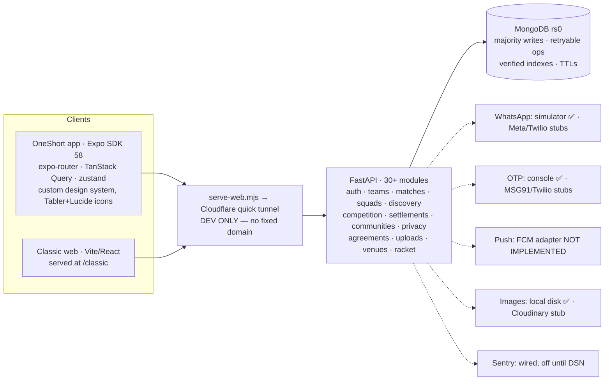

# OneShort — Phase 0 baseline audit

Date: 2026-11-09 · Branch: `develop` (14 commits ahead of `origin/develop`, push blocked on a GitHub token)
Evidence base: 215 backend tests, 10 Playwright end-to-end journeys, 17 IDOR probes, failover and restore drills, rendered screenshots — all run in this workspace. Statuses: **PASS / PARTIAL / FAIL / NOT VERIFIED** (nothing is marked working because a screen exists).

## 1. Architecture

Notes against the "expected stack": Gluestack UI, NativeWind, Reanimated-driven UI, React Hook Form and Zod are **not** in the repo; the app uses its own token-based design system (`theme.ts`) and components. That is healthy — no dependency changes proposed.

## 2. Feature-completeness matrix

**Complete and verified** (automated tests and/or rendered journeys):
| Feature | Evidence |
|---|---|
| Sport selection before login; switch sport without re-login | e2e; `preferred_sport` sync |
| Phone-OTP register/login, refresh rotation, logout, lockout | 16 auth tests + 4 new takeover regressions |
| Player/Captain as permissions on one account; mode is a UI switch | policy tests; 17 IDOR probes |
| Teams: create, roster, join requests, invites, vice-captain | e2e approval journey |
| Matches: 4-step creation wizard, squads, readiness ("Squad gaps") | e2e creation journey |
| Captain invite links via WhatsApp (wa.me) with OG previews | e2e + live header check |
| Discovery: players/teams/opponents at 5/10/20 km, `$geoNear` + 2dsphere, approximate distances only | explain-plan probe; find tests |
| Fee split: expenses → split → share → player dues → mark paid (manual, never claims processing) | e2e fee journey |
| Ratings/leaderboards (Elo-style, verified matches only) + achievements | module tests |
| CricHeroes: link + self-reported stats at onboarding, badge in discovery | 4 tests + e2e |
| Media: upload → re-encode → EXIF/GPS strip → own-URL-only fields; team/match/profile photos with fallbacks | 7 media tests; screenshots |
| Communities feed, report/hide/block | module tests |
| DPDP: Terms v2 + Privacy Notice, 3-switch consent, privacy requests, data export, erasing deletion | 7 tests + e2e |
| In-app notification inbox, read state | module tests |

**Implemented but partial / not device-verified:**
| Feature | State |
|---|---|
| Voice search | `expo-speech-recognition` wired with permissions copy; needs a dev build — **not testable in Expo Go or web e2e** |
| WhatsApp server notifications | Simulator end-to-end ✅; Meta/Twilio adapters coded, signed webhooks tested, **no production credentials** |
| Map view | Privacy-safe SVG approximation (dots, no real tiles). No maps library installed |
| Push notifications | Device tokens are registered; backend `FcmPushProvider` **raises NotImplementedError**; default is a no-op. Expo Go cannot receive remote push at all |
| Accessibility | Labels/roles used consistently; never audited with VoiceOver/TalkBack |

**Missing:** mobile crash reporting; EAS project id, signing credentials, splash-screen config; store listings/screenshots/data-safety forms; real SMS provider + India DLT registration; device-session list ("sign out everywhere") — approved-pending auth plan; ground-owner photo uploads (design doc approved, deliberately unbuilt).

**Unsafe for production — fixed in this phase:** two verified account-takeover paths (C1: `/auth/register` could seize invite-link accounts; C2: pre-registered credentials survived the owner's first OTP login). Fixed in `7461337` with 4 regression tests; `scripts/auth_risk_report.py` (read-only) found 1 at-risk demo account, now protected.

## 3. Security

Done and tested across this workspace: resource-level authorization (IDOR suite), NoSQL-operator guard, upload hardening (magic bytes, Pillow re-encode, EXIF/GPS strip, decompression caps, own-media-only URLs), request-size caps (413), per-IP+per-account rate limits and login lockout, signed-only WhatsApp webhook, redacted logs (verified against 4k real lines), scrubbed Sentry events (verified against a local sink), security headers, JWT validation (alg-none/expiry/issuer tests), today's C1/C2 fix.

Open (full detail in `docs/design/AUTH_ARCHITECTURE_REVIEW.md`, phases awaiting approval): SMS-pumping budgets and +91 allowlist before any real SMS provider; number-enumeration responses; Redis-backed rate limiting before scaling past one API instance; httpOnly cookie for web sessions; key rotation (HS256 → EdDSA/JWKS); device sessions + instant access-token revocation.

## 4. UI/UX against the reference design

The reference screens match the current information architecture (same five tabs, hero cards, quick actions, wizard, request board). Deltas needing decisions:

| Delta | Current | Reference | Decision needed |
|---|---|---|---|
| Palette | `#008C86` primary, `#063F3D` deep, `#F5C044` accent | `#16A6A0` / `#087F7A` / `#F3B65B` | One-file change in `theme.ts`; keep deep teal for text (the lighter primary fails AA contrast for small text on white) |
| Action-tile artwork | In-house flat two-tone pictograms | Dimensional colourful illustrations | Blocked on the artwork decision from the V5 shortlist (no purchase authorized) |
| Ratings display | Elo-style number + verified count | 5-star "4.2 (10)" | Product decision — stars imply review averages, our ratings are match-derived |
| Greeting emoji 👋 | Removed deliberately in V3 | Present | Your call |
| Map with markers | SVG approximation | Real map tiles + markers | Needs `react-native-maps` (dev build) or staying with list-first; cost/privacy review first |
| Voice search bar | Implemented on Explore | Same | Device test only |

## 5. Performance — NOT VERIFIED on device

Verified: indexed queries (explain-plan audit eliminated collection scans), capped list endpoints, virtualized lists, expo-image caching, failover behaviour (0 lost writes, 0 errors). Never measured: cold start, JS bundle size, memory, battery, real-device frame rates. Requires dev builds; profiling belongs in Phase 5.

## 6. Release blockers

1. **Push notifications** — the core journey's final step cannot work: FCM adapter unimplemented, no Firebase project, and Expo Go cannot receive remote push (dev build required). *Approval needed: create a Firebase project (free) for FCM/APNs.*
2. **Real SMS OTP** — console-only today; MSG91/Twilio untested, India DLT registration not started (takes days–weeks).
3. **Production hosting** — everything runs on one Mac behind expiring quick tunnels; no fixed domain; Atlas plan written, not provisioned. *Paid infrastructure approval.*
4. **Store packaging** — no EAS project/credentials, no splash config, no store assets, privacy labels, or production API URL (`extra.apiUrl` is localhost).
5. **Crash reporting on mobile** — none (backend Sentry ready, needs DSN).
6. **Legal placeholders** — company name, address, Grievance Officer, privacy email unset (production refuses to start without them); counsel review + Hindi translation pending.
7. **CI has never run** — 14 commits unpushed; GitHub token rejected.
8. **Real-device validation** — zero testing on physical iOS/Android so far.

## 7. Prioritized backlog

| P | Item | Phase | Gate |
|---|---|---|---|
| P0 | ~~C1/C2 takeover fix~~ done (`7461337`) | 1 | — |
| P0 | Push pipeline: FCM v1 adapter + token lifecycle + deep links + prefs (code now, credentials when approved) | 3 | Firebase project |
| P0 | EAS project, dev builds, splash, crash reporting, production env wiring | 5 | Expo/Apple/Google accounts |
| P1 | Auth hardening phases 1–3 (unified OTP, sessions, abuse budgets) | 1 | **Your approval on the auth review** |
| P1 | SMS provider + DLT; WhatsApp Meta credentials | 3 | Purchase approval |
| P1 | Hosting: Atlas Mumbai + API host + R2/S3 media + fixed domain | 5 | Purchase approval |
| P2 | Palette swap to reference tokens; Home/Captain polish passes; artwork once licensed | 2 | Token + artwork decisions |
| P2 | Map decision (react-native-maps vs list-first launch) | 3 | Decision |
| P3 | Device-tested voice search; rating explainability page; store listings | 4–5 | — |

## 8. Readiness scorecard

| Area | Status |
|---|---|
| Architecture | PASS |
| Security (API) | PASS — hardening plan pending approval |
| Authentication | PARTIAL — C1/C2 fixed; sessions/abuse phases await approval |
| Profile & media | PASS |
| Discovery & geo | PASS (list) / FAIL (real map) |
| UI/UX vs reference | PARTIAL |
| Notifications | PARTIAL (in-app, WhatsApp-sim) / FAIL (push) |
| Fee tracking | PASS (manual, honestly labelled) |
| Legal/DPDP | PARTIAL — code PASS, placeholders + counsel pending |
| Performance | NOT VERIFIED (device) |
| Accessibility | PARTIAL — labelled, not screen-reader audited |
| Testing | PARTIAL — backend strong; mobile unit thin; no device e2e |
| iOS release | FAIL (not started) |
| Android release | FAIL (not started) |
