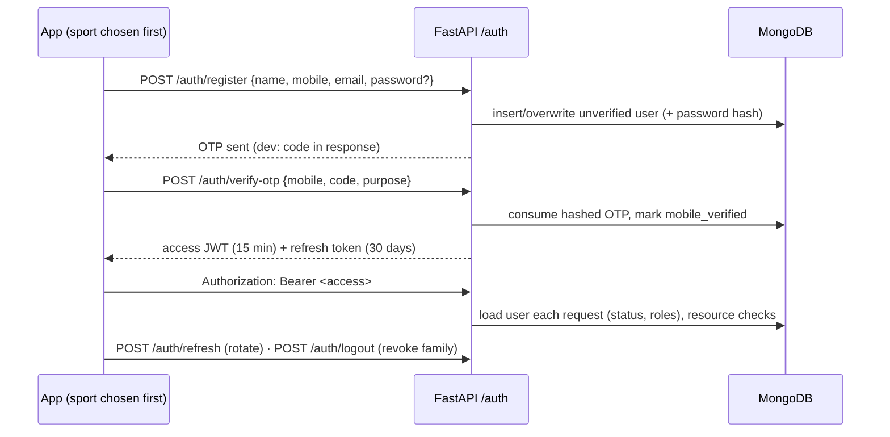
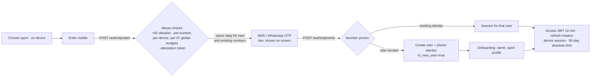

# PlayR authentication: review and proposed architecture

Status: **review only. No authentication code or identity records changed.** Awaiting approval. Date: 2026-11-09.
Scope: backend `app/modules/auth`, `app/core/security.py`, `app/api/dependencies.py`, rate limiting, invite-link registration, the mobile session layer (`mobile/src/lib/{tokens,api,auth}`), and the classic web client.

## 1. Summary

The current system is a **sound in-house design with two critical flaws**.

**What's sound:**
- OTP codes are hashed, short-lived, single-use, attempt-limited and per-number rate-limited.
- Refresh tokens are opaque, hashed, rotated, with theft detection.
- Every request reloads the user, so suspension and deletion apply immediately.
- Authorization is resource-level.

**What's critically wrong:** both flaws let an attacker who knows only a phone number take over an account (§3, C1 and C2). Both come from one design mistake: **a password and email can be attached to an account before the phone number has been proven.**

**Recommendation:** **keep the in-house system and harden it** into a phone-OTP-first identity service. Don't adopt Supabase, Firebase or Cognito now.
- A managed provider would add a second identity system next to the MongoDB `users` collection that all teams, matches and permissions reference.
- It would require an ID-mapping migration.
- It mostly offers things we can add ourselves: social login and abuse protection.

Firebase's device-attestation-backed phone auth is the strongest managed option, and the design keeps it as a later drop-in for **OTP delivery only** (§6, Phase 3).

## 2. Current architecture

| Area | Current behaviour | Verdict |
|---|---|---|
| Sport before login | Chosen on device, synced to `users.preferred_sport` after login; switching later is `PUT /users/me` with no re-login | ✅ Meets req 1 and 5 |
| OTP | 6 digits from `secrets`, Argon2-hashed, 5-minute TTL, 5 attempts then the code is deleted, single use, bound to its purpose (register, login, reset) | ✅ Good |
| OTP abuse | Per number: 30 s cooldown and 5 per hour (stored in the database). Per IP: 10 auth requests a minute (in memory) | ⚠️ No per-device or global budget, no country allowlist, no attestation or CAPTCHA (§3) |
| Dev OTP | Code echoed only when `APP_ENV` is development or test, `DEV_OTP_IN_RESPONSE=true` and the console sender is used. Production refuses the console sender | ✅ Meets req 11 |
| Access token | HS256 JWT, 15 min, `sub`/`iss`/`exp`/`type`/`jti`; validated, then the user is reloaded from the database on every request | ✅ Validation sound. ⚠️ Symmetric key, no `kid`/`aud`, no rotation |
| Refresh token | 48-byte opaque value, SHA-256 at rest, rotated on every use, atomic claim, reuse revokes the family, 30-day TTL | ✅ Strong. ⚠️ Sliding forever (no absolute session limit), no device list |
| Logout and revocation | Logout revokes the token family. Password reset and account deletion revoke all. Suspension blocks immediately | ✅ Partly. ⚠️ No "sign out everywhere", and access tokens live up to 15 min after logout |
| Mobile storage | Refresh token in iOS Keychain / Android Keystore (`expo-secure-store`), access token in memory only, single-flight refresh | ✅ Good. ⚠️ Default keychain accessibility, and any failed refresh (even a 503) logs the user out |
| Web storage | Refresh token in `sessionStorage` | ⚠️ Readable by any script on the page (XSS); should be an httpOnly cookie |
| Authorization | Resource policies (`teams/policy.py`: team captain or admin; match manager), `MatchmakerDep` (agreement + not restricted), `AdminDep`. Player/Captain **mode is a UI preference**; captain powers come from managing a team, not from a role in the token | ✅ Correctly separate from authentication (req 4 and 6). 17 IDOR probes pass |
| Second login method | Email + password (with per-account lockout), and invite-link password accounts with an unverified mobile | ❌ Source of C1 and C2. Conflicts with "phone OTP is the identity" |
| Social login | None. No identity-linking model | ⚠️ Needs an `identities` model (req 12) |

## 3. Vulnerabilities and missing controls

| # | Severity | Finding | Evidence |
|---|---|---|---|
| **C1** | **Critical** | **Takeover of invite-link accounts using only their phone number.** `/auth/register` treats any account with `mobile_verified=false` as a pending registration and overwrites its email and password. Invite-link accounts are unverified but can log in with a password, so the attacker's new credentials log straight into the victim's account (teams, squads, fee records). The victim is locked out. | Reproduced on the test database: attacker register → 201; attacker login → 200, **same user id as the victim**; victim login → 401 |
| **C2** | **Critical** | **Pre-account takeover.** An attacker registers a number they don't own with their own email and password (inert until verified). When the real owner later signs in by phone code, the login-OTP path verifies the number **and keeps the attacker's email and password**, so the attacker can log in by password. | Reproduced: attacker login before → 403 `MOBILE_NOT_VERIFIED`; victim OTP login → 200 (account email = attacker's); attacker login after → **200** |
| H1 | High | **SMS pumping / toll fraud.** No limit across numbers per device, no global daily SMS budget, and no restriction to +91. With a real provider, a script rotating IPs can send OTPs to premium international numbers at our cost. | Code review (`_issue_otp`, `RateLimitMiddleware`) |
| H2 | High | **Phone-number enumeration.** `send-otp` returns `ACCOUNT_NOT_FOUND` for unregistered numbers and `register` returns `ACCOUNT_EXISTS`, so anyone can check whether a number uses PlayR. | `test_login_via_otp_and_unknown_number` asserts this behaviour |
| M1 | Medium | Sessions never hard-expire: each rotation issues a fresh 30-day token. There's no absolute limit, no device list and no "sign out everywhere". | `_issue_tokens` |
| M2 | Medium | Access tokens can't be revoked instantly. After logout or a password reset they stay valid for up to 15 minutes. (Suspension and deletion are instant because every request reloads the user.) | `get_current_user` |
| M3 | Medium | The in-memory rate limiter isn't shared between API instances or across restarts, so limits multiply when scaling out. | `InMemoryRateLimiter` |
| M4 | Medium | The web refresh token sits in `sessionStorage`, readable by injected scripts. | `lib/tokens.ts` |
| M5 | Medium | The emails used for password login are never verified, and `PUT /users/me` can change the email freely. | `users/service.py` |
| L1 | Low | A transient refresh failure (5xx, 429, network) clears the session and signs the user out. | `lib/api.ts refresh()` |
| L2 | Low | HS256 shared secret with no key ID: rotating it logs everyone out. The issuer is still `cricketmarvels-play`. There's no `aud` claim. | `security.py`, `config.py` |
| L3 | Low | Keychain items use the default accessibility setting, so they can be restored to a new device from an encrypted backup. `AFTER_FIRST_UNLOCK_THIS_DEVICE_ONLY` is preferred. | `lib/tokens.ts` |
| L4 | Low | No device attestation (Play Integrity / App Attest) or CAPTCHA protects `send-otp`. | — |

Already good, so keep it: hashed and attempt-limited OTPs, refresh rotation with reuse detection, per-request user reload, resource-level authorization, production guards against the console OTP sender and weak secrets, redacted logs, login lockout.

## 4. Managed providers compared with hardening the current system

| | **Current system, hardened (recommended)** | Supabase Auth | Firebase Authentication | AWS Cognito |
|---|---|---|---|---|
| Fit with our data | Native: identity lives in `users`, so teams, matches and permissions stay as they are | Identity in Supabase Postgres `auth.users`; needs an ID mapping to Mongo users | Identity in Firebase; needs a Firebase UID → Mongo user mapping | Identity in a Cognito user pool; needs a `sub` mapping |
| Second identity system? | No | **Yes** | **Yes** | **Yes** |
| Phone OTP in India | Our choice of DLT-registered provider (MSG91 primary, Twilio fallback) | Twilio, Vonage, MessageBird, or MSG91 through the "Send SMS" hook; DLT still required | Google sends the SMS; reported at about $0.07 per SMS in India (sources conflict, confirm) | Native SMS OTP sign-in needs the Essentials tier (about $0.015/MAU after 10k free, US list price) plus per-SMS fees through SNS |
| Abuse protection | Build it: rate limits, budgets, +91 allowlist, Play Integrity / App Attest (Phase 3) | Basic rate limits plus CAPTCHA | **Strongest:** App Check, Play Integrity and silent-push verification built in | Adaptive auth in the Plus tier; SMS spend controls in SNS |
| Tokens | Ours (move to asymmetric keys + JWKS) | Asymmetric JWT supported | RS256 ID tokens checked with the Admin SDK | RS256 with JWKS |
| Google / Apple | Add an `identities` model (Phase 4) | Built in | Built in | Built in (hosted UI or federation) |
| Expo / React Native | Works in Expo Go today | JS SDK works in Expo Go | **Needs native modules** (dev build); no Expo Go | Amplify works; native passkeys need a dev build |
| Data residency | Wherever we host (India) | Region choice (e.g. Mumbai) | Google global infrastructure | Mumbai user pool |
| Lock-in and migration cost | None | Medium | High (proprietary password hashes) | High (hashes can't be exported) |
| Ongoing cost | SMS only (about ₹0.15–0.45 per OTP in India, vendor figures) | SMS plus MAU above the free tier | SMS (higher India rate) | MAU plus SMS |

**Decision:** Adopting any of the three would create the conflicting second identity system you asked to avoid, and would cost a migration. The two critical bugs are design fixes, not reasons to outsource. If OTP abuse becomes a real cost problem, use **Firebase phone verification only as an SMS and attestation channel**: verify its ID token server-side, then issue our own session. That keeps a single identity system.

## 5. Proposed architecture: phone OTP first

**Principles:**
1. **The phone number is the identity, proven before anything else exists.** Verification creates the account; nothing is attached to an unverified record. Email and password become optional add-ons, set only while signed in, with the email verified by link.
2. **One identity model, many sign-in methods.** An `identities` collection `{user_id, provider: phone|google|apple|password, subject, verified_at}` with a unique index on `(provider, subject)`. Google and Apple later become new rows linked to the same user.
3. **Sessions are first-class.** A `sessions` record per device (platform, app version, last seen) owns the refresh-token family. Users can see and revoke devices, and "Sign out everywhere" is available. Absolute limit 90 days, idle limit 30 days.
4. **Instant revocation.** `users.sessions_valid_after` is checked against the access token's `iat` in `get_current_user`, which already loads the user, so it adds no extra query. Logout-all, a password change or a security event invalidates access tokens immediately.
5. **Asymmetric signing.** EdDSA (or RS256) with a `kid` and a JWKS endpoint; issuer `playr`, audience `playr-api`. Keys rotate without logging anyone out.
6. **Authorization unchanged.** Resource policies stay the source of truth. `roles` holds only `admin`; captain powers come from team management. Player/Captain mode stays a UI preference (`users.last_mode`), and switching it needs no new token. The sport switch stays `PUT /users/me`.
7. **Abuse controls (Redis).** Per number: 30 s → 60 s → 120 s cooldown, 5 per hour, 10 per day. Per device: 5 numbers per day. Per IP: 20 per hour. A global daily SMS budget with alerts. **Only +91 for SMS** (configurable). Verify: 5 attempts per code; 3 lockouts lock the number for 1 h. Play Integrity / App Attest token required on `otp/start` from native apps, hCaptcha on web.
8. **Dev and test OTP without SMS.** The console sender plus on-screen code in development (unchanged). Plus **test numbers**: the reserved fictional range +44 7700 900xxx with a fixed code, enabled only on development and staging. Production refuses to start if test numbers are enabled.
9. **Client storage.**
   - Native: refresh token in Keychain/Keystore with `AFTER_FIRST_UNLOCK_THIS_DEVICE_ONLY`; access token in memory.
   - Web: refresh token in an httpOnly, Secure, `SameSite=Strict` cookie scoped to `/api/v1/auth`.
   - Refresh clears the session only on 401; transient errors retry.

## 6. Migration plan (non-destructive; existing users, teams and matches unchanged)

| Phase | What | Data impact | Approval |
|---|---|---|---|
| **0 · Hotfix (days)** | Close C1 and C2: `register` never overwrites credentials on an existing record; email and password are accepted only after OTP verification; unverified registrations expire after 24 h and can't hold a password; login-OTP verification clears any credentials an unverified record had; invite-link sign-up verifies the number by OTP before the account can log in. Plus a script that lists accounts at risk (unverified with a password, or `verified_via: captain_invite`) as a dry run. | Read-only report first; any clean-up runs only after review | **Needed now** |
| 1 · Unified OTP API | `POST /auth/otp/start` and `/auth/otp/verify` (one call creates or signs in, generic replies, `is_new_user`). Old endpoints remain as compatible aliases for one release. App login becomes one screen: sport → mobile → code → onboarding when new. | Additive: backfill `identities` with a phone row for each verified user (dry run, then apply) | Yes |
| 2 · Sessions and keys | `sessions` collection, device list, sign out everywhere, absolute limit, `sessions_valid_after`, EdDSA keys + JWKS, issuer `playr`. Dual-verify old HS256 tokens for one access-token lifetime. | Additive | Yes |
| 3 · Abuse protection | Redis limiter, budgets, +91 allowlist, attestation, test numbers, MSG91 (DLT) + Twilio fallback, alerts | Config | Yes |
| 4 · Web cookie, then Google/Apple | httpOnly cookie for web. Then Google/Apple sign-in: verify ID tokens against Google/Apple JWKS, link to the existing user when signed in, otherwise ask for the phone number first. | Additive | Later |
| 5 · Password login | Keep as optional, signed-in-only, with verified email, or retire. Your decision. | — | Yes |

**Rollback:** each phase is additive and behind a setting (`AUTH_FLOW=v1|v2`). Old endpoints stay until the apps in the field have updated.

## 7. Exact files and APIs that would change

### Backend
| File | Change |
|---|---|
| `app/modules/auth/service.py` | Phase 0 fixes. New `start_otp` / `verify_otp_v2` (create-or-sign-in, generic replies, `is_new_user`), session creation, absolute limit, `sessions_valid_after` |
| `app/modules/auth/router.py` | `POST /auth/otp/start`, `POST /auth/otp/verify`, `GET /auth/sessions`, `DELETE /auth/sessions/{id}`, `POST /auth/logout-all`, `GET /.well-known/jwks.json`. Existing `register`, `send-otp`, `verify-otp`, `refresh`, `logout` kept as aliases |
| `app/modules/auth/schemas.py` | `OtpStartIn/Out`, `OtpVerifyIn` (+ `device`, `attestation`), `TokenOut.is_new_user`, `SessionOut` |
| `app/modules/auth/abuse.py` (new) | Redis budgets, cooldown ladder, country allowlist, attestation check, test numbers |
| `app/modules/auth/identities.py` (new) | Identity lookup and linking (phone now; Google/Apple later) |
| `app/core/security.py` | EdDSA/RS256 signing with `kid`, JWKS, `aud`, dual verification during rollout |
| `app/api/dependencies.py` | `get_current_user`: check `iat` against `sessions_valid_after`; no extra query |
| `app/core/config.py` | `AUTH_FLOW`, `OTP_ALLOWED_COUNTRY_CODES`, `OTP_DAILY_BUDGET`, `TEST_OTP_NUMBERS` (refused in production), key paths, session limits |
| `app/core/middleware.py` + `container.py` | Redis-backed rate limiter |
| `app/modules/joinlinks/service.py`, `router.py` | Invite sign-up goes through phone OTP |
| `app/modules/users/service.py`, `schemas.py` | Email change triggers verification; `last_mode` |
| `app/infrastructure/database/indexes.py` | `identities` (unique provider+subject), `sessions` (user, last_seen; TTL on expiry), `users.sessions_valid_after` |
| `scripts/auth_risk_report.py` (new), `scripts/backfill_identities.py` (new) | Dry-run-first data scripts |

### Mobile (UI keeps PlayR teal and the `#F5F6F0` canvas)
| File | Change |
|---|---|
| `src/app/(auth)/login.tsx` | One flow: mobile → code; new numbers go to onboarding. Email/password behind "Other ways to sign in" |
| `src/lib/api.ts` | Clear the session only on 401; retry transient errors |
| `src/lib/tokens.ts` | `keychainAccessible: AFTER_FIRST_UNLOCK_THIS_DEVICE_ONLY`; web uses the cookie |
| `src/lib/auth.tsx` | `is_new_user` → onboarding; sign out everywhere |
| `src/app/join/[code].tsx` | Invite sign-up by phone OTP |
| `src/app/profile.tsx` (+ new `src/app/sessions.tsx`) | Signed-in devices, sign out everywhere |

### Classic web (`frontend/`)
Uses the same aliases; it moves to the new endpoints in Phase 1.

## 8. Tests to add (automated)

**Takeover regressions:**
- C1: register can't overwrite an invite account.
- C2: a pre-registered password is dead after an OTP login.

**OTP:**
- Generic replies for unknown and known numbers.
- Cooldown ladder; per-device, per-IP and global budgets.
- Non-+91 numbers refused.
- Lockout after repeated failures.
- Test numbers refused in production settings.
- Dev code only in development.

**Sessions:**
- Absolute limit.
- Idle expiry.
- Logout revokes one device.
- Sign out everywhere kills access tokens immediately (`sessions_valid_after`).
- Refresh reuse revokes the family.
- Suspension and deletion during a live session.

**Tokens:**
- Wrong `aud`, wrong `iss`, `alg=none`, expired, unknown `kid`, and an HS256 token after cutover are all rejected.

**Authorization:**
- Mode switch needs no new token, and grants nothing.
- Captain actions still require team management (existing IDOR suite).
- Sport switch keeps the session.

**Identities:**
- Backfill is idempotent.
- Google/Apple linking requires a signed-in session (Phase 4).

**End to end (Playwright):**
- Sport → phone → code → onboarding for a new number.
- Returning number goes straight home.
- Sign out everywhere.
