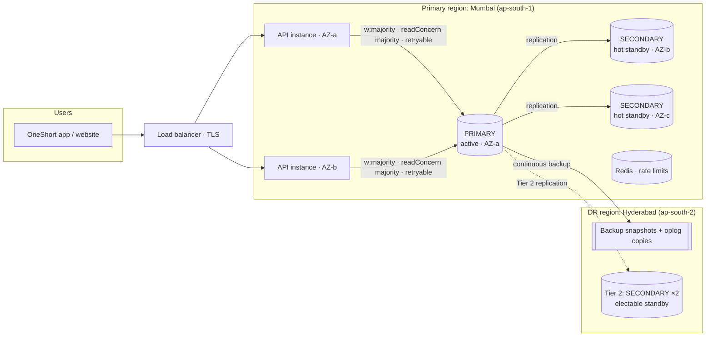

# Database reliability: high availability, failover, backups and disaster recovery

Status: client-side failover handling is **implemented and tested**. The production topology below is the **plan to provision**. Pilot backups (scripts) are **implemented**. Date: 2026-11-09.

## 1. Targets

| Scenario | RPO (data loss) | RTO (downtime) | How |
|---|---|---|---|
| One database node fails, or one availability zone goes down | **0** | **< 30 s**, automatic | Replica set election; majority writes; retryable operations |
| Bad deploy, accidental delete, corrupted data | **≈ 1 min**, to any point in the last 7 days | 30–60 min | Point-in-time restore (PITR) to a new cluster, then switch over |
| Whole primary region lost (Tier 1) | ≤ 1 h | 2–4 h, manual | Restore cross-region backup copy in the DR region |
| Whole primary region lost (Tier 2) | ≈ 0 | **< 1 min**, automatic | Multi-region replica set, 2-2-1 across three Indian regions |
| Cloud account compromised or ransomware | ≤ 24 h | 4–8 h | Immutable backups (Backup Compliance Policy) plus an off-cloud copy in a separate account |

## 2. Topology: active / passive

- **Active–active app tier.** API instances are stateless and run in at least two AZs behind the load balancer. Losing one instance or one AZ only reduces capacity. Rate limits move to Redis so every instance sees the same counters (today they're in memory, which is fine for one instance).
- **Active–passive data tier.** A single **primary** takes all writes. **Secondaries** are hot standbys in other AZs, replicating continuously. If the primary fails, the secondaries elect a new primary within seconds. No human is involved, and the app reconnects by itself.
- **Managed service: MongoDB Atlas (M30 or larger for production, dedicated).** It provides the replica set across three AZs, continuous backup with PITR, cross-region backup copies, encryption at rest, private networking (VPC peering / PrivateLink) and alerting. Self-hosting is possible (Percona Server for MongoDB plus Percona Backup for MongoDB for PITR), but it costs more engineering time than it saves at our scale.
- **Data stays in India.** Mumbai is primary and Hyderabad is DR, matching the Privacy Notice (§5).

### Tier 2: automatic regional failover (when the business needs it)

An automatic election needs a majority of voting members, so surviving the loss of a whole region needs three regions. Atlas multi-region (multi-cloud if needed) keeps everything in India:

| Region | Electable nodes | Priority |
|---|---|---|
| AWS Mumbai (primary) | 2 | 7 |
| AWS Hyderabad | 2 | 6 |
| GCP Delhi or Azure Pune (tie-breaker) | 1 | 5 |

If Mumbai is lost, 3 of the 5 votes remain, so Hyderabad is promoted automatically. Cost is roughly 1.7× Tier 1. Start with Tier 1 and move to Tier 2 when downtime costs justify it.

## 3. How the app behaves during failover (implemented)

These are configured in `backend/app/infrastructure/database/mongo.py` and `config.py`.

| Setting | Value | Why |
|---|---|---|
| Write concern | `w: "majority"`, `j: true` | A write is acknowledged only when a majority has it on disk, so it can't be rolled back when the primary dies |
| Read concern | `majority` | Readers never see data that a failover could roll back |
| Retryable writes and reads | on | An operation interrupted by an election is resent once to the new primary, safely and exactly once |
| Server selection timeout | 15 s (`MONGODB_SERVER_SELECTION_TIMEOUT_MS`) | Longer than an election (about 10–12 s after a crash), so requests wait for the new primary instead of failing |
| Transactions | `with_transaction` | Retries transient errors and unknown commit results automatically |
| Connection pool | 100 per instance (`MONGODB_MAX_POOL_SIZE`) | Bounded, so a burst can't exhaust the cluster's connections |
| `/health/ready` | `degraded / no_primary` during an election, HTTP 200 | Monitoring sees the election, but the load balancer doesn't pull every instance during a 10-second election |

### Verified by test (3-node replica set, 8 concurrent writers, transactions every 10th write)

| Event | Before tuning (5 s selection timeout) | After tuning |
|---|---|---|
| Graceful step-down of the primary | 0 errors | 0 errors |
| `kill -9` of the primary (crash) | **8 failed requests** while the election ran | **0 failed requests** |
| Acknowledged writes lost | 0 | **0** (7,229 of 7,229 kept) |
| Duplicate writes from retries | 0 | 0 |
| Transactions | 752 OK | 722 OK, 0 failed |

Users see a pause of a few seconds during a crash failover, not errors.

## 4. Continuous backup strategy (3-2-1)

| Layer | What | Retention | RPO |
|---|---|---|---|
| Continuous (PITR) | Atlas Continuous Cloud Backup: snapshots plus a continuous oplog stream | 7-day restore window | ≈ 1 min, to any second in the window |
| Snapshots | Every 6 h, daily, weekly, monthly | 6-hourly 2 days · daily 35 days · weekly 8 weeks · monthly 12 months | 6 h |
| Cross-region copy | Snapshots and oplog copied to Hyderabad | Same as above | Same |
| Immutable | Atlas Backup Compliance Policy: backups can't be deleted or shortened, even by an admin | Policy period | — |
| Off-cloud copy | Daily `mongodump --oplog` archive to Cloudflare R2 (separate account, object lock) | 35 days | 24 h |

- **Encryption:** at rest (Atlas default, optionally customer-managed keys) and in transit (TLS). Off-cloud archives are encrypted before upload.
- **Monitoring:** alerts on backup failure, replication lag over 60 s, no primary, oplog window under 24 h, disk over 80 %, and connections over 80 %.

### Pilot setup today (this Mac): implemented in `scripts/db/`

| Script | What it does |
|---|---|
| `backup.sh` | Consistent dump (`--oplog`) with a SHA-256 checksum and a manifest of collection counts. Keeps every backup for 48 h, then one per day for 35 days. Copies off the machine when `BACKUP_RCLONE_REMOTE` is set. |
| `restore-verify.sh` | Checks the checksum, restores into a throwaway database, compares counts with the manifest, then drops it. Never touches the live database. |
| `schedule.sh install` | Hourly backup plus a daily 04:30 restore check (launchd). RPO ≤ 1 h. |

First run verified: 48 collections and 5,077 documents restored and checked in 5 s.

A backup on the same disk doesn't survive losing the Mac. Set `BACKUP_RCLONE_REMOTE` for an off-machine copy until production moves to Atlas.

## 5. Disaster recovery runbooks

The on-call engineer runs these. Write each incident into the incident log; personal-data incidents also follow `docs/legal/BREACH_RESPONSE.md`.

### A. Node or AZ failure
Automatic. Check that the Atlas alert has cleared, the `/health/ready` status is `ok`, and replication lag is back under 10 s. Atlas replaces the failed node. **No action needed.**

### B. Bad deploy, accidental deletion, data corruption
1. Freeze writes: put the API in maintenance mode (scale to 0, or return 503 from the load balancer).
2. Find the last good moment from `audit_logs`, deploy time and Sentry.
3. In Atlas, **restore to a point in time** just before it, into a **new cluster** (never over the live one).
4. Check the restore: counts and a sample of recent records, using the `restore-verify.sh` logic.
5. Choose a path:
   - **Partial damage:** copy the affected collections back to live (`mongodump` from the restore, then `mongorestore --nsInclude`).
   - **Widespread damage:** point `MONGODB_URI` at the restored cluster and redeploy.
6. Unfreeze, then post-mortem.

Target: 30–60 min.

### C. Region outage (Tier 1)
1. Confirm the provider status page shows a regional outage expected to last more than 1 h.
2. Restore the latest cross-region snapshot plus oplog in **Hyderabad** to a new cluster.
3. Deploy API instances in Hyderabad (same image) with `MONGODB_URI` pointing at it. Switch DNS (60 s TTL).
4. When Mumbai returns, keep Hyderabad as primary or plan a controlled move back.

Target: 2–4 h. Tier 2 makes this automatic.

### D. Credential compromise or ransomware
1. Rotate Atlas, database and cloud credentials, and revoke API keys.
2. Restore from **immutable** backups (Compliance Policy) or the off-cloud R2 copy, into a new project.
3. Follow the breach runbook: report to the Board within 72 h and to CERT-In within 6 h.

## 6. Drills (a backup you haven't restored isn't a backup)

| Drill | Frequency | Pass criteria |
|---|---|---|
| Automated restore check | Daily (`restore-verify.sh`, or an Atlas restore to staging) | Checksum OK, counts match |
| Failover test (Atlas "Test Failover") | Quarterly, off-peak | 0 failed requests, `/health/ready` back to `ok` in < 30 s |
| PITR restore to staging | Quarterly | Restored to the chosen second, app smoke tests pass |
| Region DR game day | Twice a year | Hyderabad serving within the 4 h RTO |

## 7. Before launch

1. Create the Atlas project in Mumbai (M30 or larger, 3 AZs). Turn on Continuous Cloud Backup with a 7-day PITR window, copies to Hyderabad, and the Backup Compliance Policy.
2. Use private networking from the API to Atlas, with IP access only from the API subnets.
3. Point `MONGODB_URI` at the Atlas SRV string (`retryWrites` and majority are already set in code).
4. Set up the daily off-cloud archive to R2 (`backup.sh` from a scheduled job with `BACKUP_RCLONE_REMOTE`).
5. Configure the alerts in §4 and send them to on-call.
6. Run one failover test and one PITR restore drill, and record the results here.
