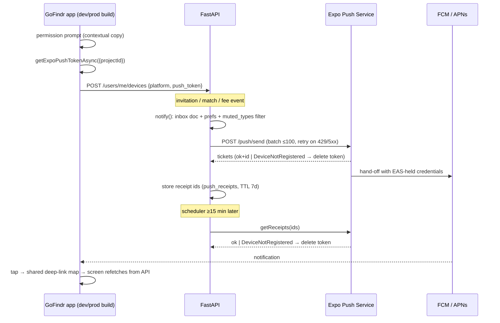

# Push notifications: architecture, setup and device verification

Status: **code complete and tested server-side; delivery BLOCKED on an EAS project + FCM/APNs credentials and development builds.** Date: 2026-11-09.

## 1. Architecture (Expo Push Service)

One token type end to end: the app registers an **Expo push token** (`ExponentPushToken[…]`); the backend sends through the Expo Push Service, which fans out to FCM (Android) and APNs (iOS) using credentials stored in the EAS project. We never mix native FCM/APNs device tokens into this path — tokens from older builds are detected and deleted.

Design rules proven by tests:
- **Invitation creation never depends on push.** The inbox document is written first; push is a secondary channel whose failure only logs (`notification.secondary_channel_failed`).
- **Payloads carry display text and opaque ids only** (`type`, `invitation_id`, `match_id`…). The target screen refetches; authorization is checked server-side on every call. A forged payload can at most open a screen that then 403s.
- **Delivery is never claimed from an accepted request**: tickets *and* receipts are processed; `DeviceNotRegistered` at either step deletes the token.
- **Who can trigger a push:** nobody directly — pushes exist only as a side effect of authorized actions (invite, accept, reminder), behind the same permission checks as the action itself.

Key code: `backend/app/infrastructure/integrations/push.py` (provider), `backend/app/modules/notifications/service.py` (fan-out, receipts), `mobile/src/lib/push.ts` + `mobile/src/lib/notify-nav.ts` (handler, tap navigation, parked taps when signed out), `mobile/src/lib/device.ts` (registration).

## 2. Configuration

| Setting | Value |
|---|---|
| `PUSH_PROVIDER` | `expo` to enable (default `none` = in-app only) |
| `EXPO_PUSH_ACCESS_TOKEN` | Only if "Enhanced push security" is turned on in the Expo account |
| Token refresh | App re-registers on every sign-in; server upserts by token |
| Invalid tokens | Deleted on ticket/receipt `DeviceNotRegistered`; devices removed on account deletion |
| Preferences | `notification_prefs.push` + per-type `muted_types` (already enforced in `notify()`) |

## 3. One-time setup (needs your accounts — exact steps)

1. **EAS project** (free): `cd mobile && npx eas-cli@latest init` with your Expo account → writes `extra.eas.projectId` into `app.json`. Commit it.
2. **Android (FCM v1)**: Firebase console → create project "GoFindr" → add Android app `in.gofindr.app` → download `google-services.json` into `mobile/` and reference it as `expo.android.googleServicesFile`; then Project settings → Service accounts → generate the service-account key and upload: `npx eas-cli credentials` → Android → `Google Service Account Key for FCM v1`.
3. **iOS (APNs)**: needs the Apple Developer Program (US$99/yr). `npx eas-cli credentials` → iOS → let EAS create/manage the APNs key against bundle id `in.gofindr.app`.
4. **Development builds** (Expo Go cannot receive remote push): `npx eas-cli build --profile development --platform android` and `--platform ios`, install on the two test phones.
5. **Backend**: set `PUSH_PROVIDER=expo` and restart. Nothing else — FCM/APNs secrets never touch our servers.

## 4. P0 device verification plan (run after step 5)

Accounts: two fresh registrations on the dev builds (fictional +44 7700 900xxx numbers work against the dev API). Evidence to capture per scenario: screen recording + the API log lines `push.expo.*` / `notification.*` (already free of tokens and PII).

| Scenario | Steps | Pass when |
|---|---|---|
| A: iPhone receives | Android captain → Find Players → Invite → iPhone gets "GoFindr — invitation" push → tap → Home invitation card → Accept → captain confirms → squad +1 | Push arrives; tap lands on the card; accept→confirm updates both phones |
| B: Android receives | Mirror of A | Same |
| C: App terminated | Force-quit the recipient app before inviting | Cold-start tap still lands on the invitation (parked-tap store) |
| D: Push unavailable | Deny notification permission on the recipient | Invitation still appears in Home + inbox; no errors |
| E: Last seat race | Two accepted invitations, captain confirms both fast | Exactly one confirmed, other sees "squad is already full" (server-proven by `test_invitation_concurrency.py`) |
| Extra | Tap the same notification twice; log out then tap | No duplicate accept (server state machine); tap parked until sign-in completes |

Statuses stay `BLOCKED` until this table is executed on physical devices.

## 5. Invitation states (server-enforced, tested)

`PENDING → ACCEPTED → CONFIRMED` (invite; confirm atomically claims a seat under a capacity guard in a transaction) · `PENDING → REJECTED` · `→ CANCELLED` (captain) · `→ EXPIRED` (TTL, scheduler). Duplicates are rejected (`DUPLICATE_INVITATION`), transitions validated (`ensure_transition`), double-booking blocked, and every state change notifies the other party in-app (+push when enabled).
